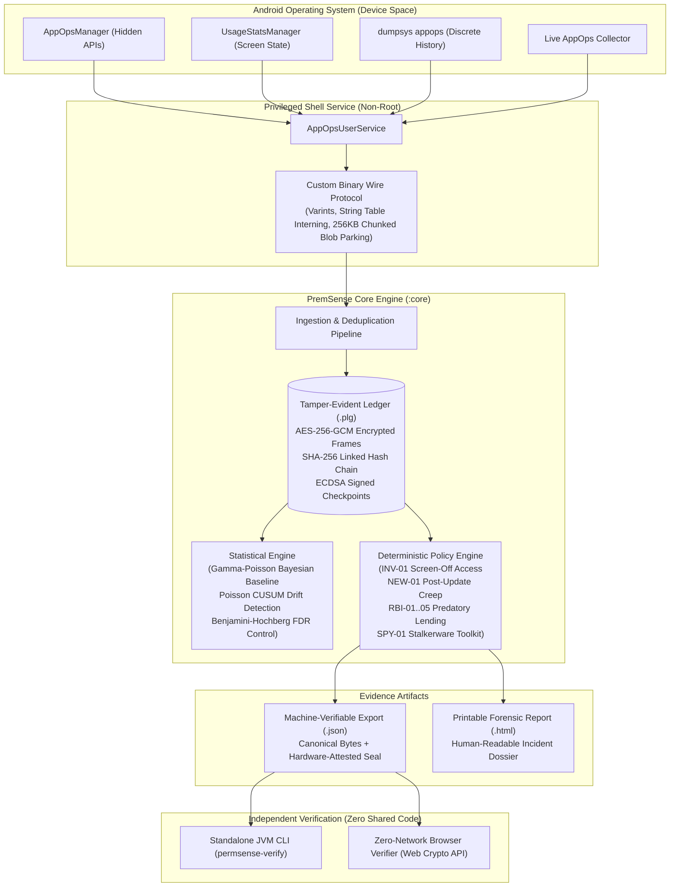

# PremSense 🛡️
### Zero-Network, Tamper-Evident Android Privacy Auditor & Forensic Evidence Engine

[](https://kotlinlang.org/)
[-3DDC84.svg?logo=android&logoColor=white)](https://developer.android.com)
[](app/src/main/AndroidManifest.xml)
[](core/src/main/kotlin/com/ojas/permsense/ledger/AndroidKeystoreSigner.kt)
[](verifier/)
[](LICENSE)

---

## 📌 Executive Summary

Modern mobile permissions provide an illusion of privacy. Apps demand runtime permissions under the guise of one-time setup, then silently harvest private telemetry—camera, microphone, background location, contacts, and text messages—when the user is asleep or unaware. In many regions, predatory lending apps and consumer stalkerware abuse these privileges to conduct systematic extortion. When victims or security auditors attempt to report these violations, they have **zero verifiable forensic evidence**.

**PremSense** is an on-device Android privacy auditor and cryptographic evidence engine. Operating completely without root via **Shizuku** privileged services, PremSense continuously inspects low-level `AppOps` telemetry, detects anomalous data access patterns using classical Bayesian statistics, enforces regulatory compliance policies, and records an **unalterable, cryptographically signed ledger** backed by Android Keystore hardware attestation.

> **The Zero-Network Guarantee:**  
> PremSense deliberately does **NOT** declare `android.permission.INTERNET` in its manifest. Not a single byte of telemetry ever leaves your physical device. All sensing, Bayesian inferencing, ledger storage, and evidence generation are performed 100% locally.

---

## 🏗️ Architecture & Forensic Data Flow

PremSense separates observation, storage, inference, and verification into isolated, modular boundaries across four distinct Gradle modules:



---

## ⚡ Core Capabilities

### 1. Multi-Tier Sensing Pipeline
PremSense gathers system-level activity across four distinct sensing tiers without requiring root access:
* **Tier 0 (Inventory & Capabilities):** Tracks package installations, version codes, requested vs. granted permissions, active accessibility services, notification listeners, and device admin bindings.
* **Tier 1 (Periodic AppOps Polling):** Queries per-app, per-operation access and rejection timestamps directly via hidden `AppOpsManager` interfaces.
* **Tier 2 (Discrete OS History):** Extracts the operating system's historical discrete access records for camera, microphone, and location via `dumpsys appops --history --include-discrete`.
* **Tier 3 (Real-Time Event Collector):** Streams live `AppOps` state changes in real time through a privileged daemon hosted by Shizuku.

### 2. Tamper-Evident Hardware-Attested Ledger
* **Append-Only Encrypted Storage (`.plg`):** Stores timestamped records inside custom binary framed structures (`PFRM`) encrypted at rest with **AES-256-GCM** using unique per-frame random IVs.
* **Continuous Cryptographic Hash Chaining:** Every ledger record contains the SHA-256 digest of its preceding record. Modifying or deleting any single past event breaks the entire hash chain forward.
* **Android Keystore Hardware Attestation:** Periodic checkpoints and export seals are signed using non-exportable **ECDSA P-256** keys backed by the device's **StrongBox** or **Trusted Execution Environment (TEE)**.
* **Crash Resilience & Auto-Recovery:** Incomplete or interrupted writes (e.g., unexpected OS process termination) are dynamically quarantined and truncated to the last known valid cryptographic boundary upon startup.

### 3. Transparent Classical Statistics (No Black-Box AI Hallucinations)
PremSense rejects opaque machine learning models in favor of rigorous, mathematically verifiable statistics:
* **Bayesian Gamma-Poisson Baseline:** Models natural background app activity frequencies over time and updates conjugate priors deterministically.
* **Poisson CUSUM (Cumulative Sum):** Detects abrupt structural shifts in permission usage frequency.
* **Benjamini-Hochberg FDR Control:** Multi-hypothesis testing correction prevents false alarms across hundreds of simultaneous app-op combinations.

### 4. Regulatory & Security Policy Packs
PremSense ships with deterministic rule packs that enforce legal regulations and flag surveillance toolkits:

| Rule ID | Name | Threat Model / Legal Basis |
| :--- | :--- | :--- |
| **`INV-01`** | **Invisible Access** | Sensitive operations (camera, mic, location) accessed while the screen is locked/off and no foreground service exists. |
| **`NEW-01`** | **Update Behavioral Shift** | An app begins accessing sensitive resources for the first time immediately following a version-code upgrade. |
| **`DEBT-01`** | **Permission Debt** | A sensitive runtime permission held for 30+ consecutive days with zero observed use. |
| **`RBI-01..04`** | **Digital Lending Prohibitions** | Detects digital lending applications requesting or reading contacts, call logs, media, or SMS—explicitly violating India's **Reserve Bank of India (RBI) Digital Lending Guidelines**. |
| **`RBI-05`** | **Post-Onboarding Surveillance** | Lending apps continuing to access camera, mic, or location outside of the initial KYC/onboarding window. |
| **`SPY-01`** | **Stalkerware Toolkit** | High-privilege access combinations: Accessibility Service / Device Admin combined with Background Location or SMS interception. |

---

## 🛠️ Low-Level Engineering: Cracking the 1MB Binder IPC Wall

During initial development, running full-system `AppOps` scans on real-world test devices (with 200+ installed applications) immediately crashed the process with Android's infamous:
```
android.os.TransactionTooLargeException: data parcel size 1214840 bytes exceeds 1MB limit
```

Android's Binder IPC architecture shares a single ~1MB memory buffer across the entire process. Transferring rich forensic telemetry across process boundaries required designing an industrial-grade IPC subsystem:

1. **Granular Operation Splitting:** Rather than querying all operations in a single massive bulk transaction, the privileged service partitions queries operation-by-operation.
2. **Compact Binary Wire Protocol:**
   * Swapped bulky JSON representations and 64-character hex-encoded SHA-256 hashes (128 bytes in UTF-16) for raw 32-byte binary payloads.
   * Implemented **String Table Interning**: Repeated package names and operation identifiers are indexed once in a header dictionary, reducing recurring observation footprints from ~350 bytes down to ~70 bytes.
   * Utilized variable-length integer (`varint`) encoding for timestamps and delta offsets.
3. **In-Memory Blob Parking with Chunked Transfers:**
   * When query payloads exceed safe Binder thresholds, the privileged service parks the serialized payload in-memory under an ephemeral UUID.
   * The app receives a metadata descriptor (`token`, `size`, `crc32`) and streams the payload back across Binder in bite-sized **256KB chunks**.
   * Each chunk is sequentially validated, followed by an end-to-end CRC32 checksum verification upon reassembly.
4. **Failsafe App-By-App Fallback:** Handled edge-case scenarios where `PackageManager.getInstalledPackages()` itself overflows Binder on OEM devices packed with vendor bloatware.

---

## 🧪 Ground-Truth Test Harness: QuickCash (`:probe`)

To guarantee forensic accuracy under real-world conditions, PremSense includes **QuickCash** (`:probe`), a synthetic dual-version test application that simulates malicious permission creep:

* **QuickCash v1 (Benign Onboarding):** Requests permissions and exercises the camera on-screen during simulated KYC onboarding.
* **QuickCash v2 (Malicious Update Drift):** Deployed in-place as an update. Launches a hidden background JobScheduler service that silently harvests contacts while the phone screen is turned off.
* **Signed Intended-Log:** QuickCash signs its own intended action log via hardware attestation, providing mathematical ground-truth to measure against PremSense's ledger.

---

## 📁 Repository Structure

```
PREMSENSE/
├── app/                     # Android Application Module
│   ├── src/main/java/       # Jetpack Compose UI (M3), WorkManager workers, Shizuku service bindings
│   └── src/main/res/        # UI resources, bilingual localization (English + Hindi)
├── core/                    # Pure Kotlin JVM Library (Zero Android Framework Dependencies)
│   ├── baseline/            # Bayesian Gamma-Poisson modeling & CUSUM drift detection
│   ├── findings/            # Incident triaging & prioritization engine
│   ├── judgement/           # Policy engines (RBI-01..05, INV-01, NEW-01, SPY-01)
│   ├── ledger/              # AES-256-GCM framed storage, SHA-256 hash chaining
│   ├── wire/                # Compact binary wire format & chunked blob streaming
│   └── export/              # Canonical evidence serialization & HTML report generation
├── verifier/                # Standalone Third-Party Verifier (Independent JVM CLI + Web)
│   ├── src/main/kotlin/     # Hand-written MiniJson, DER/ASN.1 parser, X.509 cert chain validator
│   └── src/main/resources/  # Bundled Google Hardware Attestation root certificates
├── probe/                   # Synthetic "QuickCash" test harness app (v1 / v2 update drift)
└── tools/
    └── probe/probe.sh       # Automated ADB driving script for live interactive testing
```

---

## 🚀 Getting Started

### Prerequisites
* **JDK 17 or higher**
* **Android SDK** (API Level 35+, Build Tools 35.0.0+)
* A physical Android device or emulator running **Android 10 (API 29) to Android 16 (API 37)**
* [Shizuku](https://shizuku.rikka.app/) installed and running via wireless debugging or ADB

### 1. Build the Entire Stack
```bash
# Clone the repository
git clone https://github.com/pranshu775singh-oss/PREMSENSE.git
cd PREMSENSE

# Build all APKs and the standalone verifier CLI
./gradlew :app:assembleDebug :probe:assembleDebug :verifier:installDist
```

### 2. Install & Grant Privileges
Install PremSense on your test device and configure privileged permissions via ADB:
```bash
adb install -r app/build/outputs/apk/debug/app-debug.apk

# Grant privileged sensing permissions
adb shell pm grant com.ojas.permsense android.permission.GET_APP_OPS_STATS
adb shell pm grant com.ojas.permsense android.permission.DUMP
adb shell pm grant com.ojas.permsense android.permission.PACKAGE_USAGE_STATS
adb shell pm grant com.ojas.permsense android.permission.POST_NOTIFICATIONS
```

### 3. Run the Automated Live Demo
Run the end-to-end demonstration using the included test harness script:
```bash
chmod +x tools/probe/probe.sh
./tools/probe/probe.sh demo
```
**Interactive Demo Sequence:**
1. Installs QuickCash v1 (PremSense immediately fires `RBI-01` because contacts permissions were requested).
2. Simulates legitimate on-screen KYC camera access (`RBI-05`).
3. Updates QuickCash to v2 in-place over ADB.
4. QuickCash v2 executes a stealth background contact harvest while the phone screen is powered off.
5. User wakes the device: PremSense instantly flags `RBI-01` (Forbidden access), `INV-01` (Screen-off invisible access), and `NEW-01` (Behavioral shift following update).
6. Tapping remediation directly revokes the app's offending permissions.
7. Generates a signed cryptographic evidence export (`.json` + `.html`).

---

## 🔍 Independent Evidence Verification

PremSense produces evidence designed for third-party judicial, forensic, and administrative scrutiny. The verifier module is **100% isolated**—it shares zero code with the app or core engine and contains its own hand-written JSON and DER certificate parsers.

### Verify via Command Line (Offline JVM CLI)
```bash
./verifier/build/install/permsense-verify/bin/permsense-verify export_report.json --require-hardware
```

**Example Verification Output:**
```text
  [ok]   File format: permsense-evidence v1
  [ok]   Raw bytes digest: SHA-256 match
  [ok]   Signature: ECDSA P-256 valid
  [ok]   Hardware attestation: Rooted in Google TEE/StrongBox root authority
  [ok]   Ledger hash chain: 1,482 records intact, 0 breaks
  [ok]   Checkpoints: 12 signed checkpoints valid

RESULT: VERIFIED AND HARDWARE-ATTESTED.
Nothing has been altered, and the signing key lives in secure hardware on a genuine device.
```

### Tamper-Proofing Test
Modify even a single byte inside `export_report.json` using any text editor and re-run:
```bash
./verifier/build/install/permsense-verify/bin/permsense-verify export_report.json
# Output: [FAIL] Raw bytes digest mismatch -> RESULT: REJECTED.
```

---

## 🔐 Threat Model & Honest Forensic Limitations

PremSense adheres to absolute transparency regarding cryptographic boundaries:

* **What PremSense Proves:**  
  Guarantees integrity **after recording**. Proves mathematically that telemetry recorded by PremSense has not been modified, pruned, or fabricated since it was written to the ledger, and that the signing key is backed by hardware attestation.
* **What PremSense Does NOT Prove:**  
  It cannot guarantee that the underlying Android operating system kernel was telling the truth if the device was already rooted or compromised by a kernel-level exploit prior to recording. PremSense makes no warranties regarding legal admissibility in specific jurisdictions.

---

## 🌐 Internationalization (i18n)

PremSense is engineered for global accessibility, featuring native support for:
* **English (`en`)**
* **Hindi (`hi` - हिन्दी)** — Full interface, notifications, and localized forensic HTML reports.

---

## 📄 License

This project is licensed under the **Apache License 2.0**. See the [LICENSE](LICENSE) file for details.
